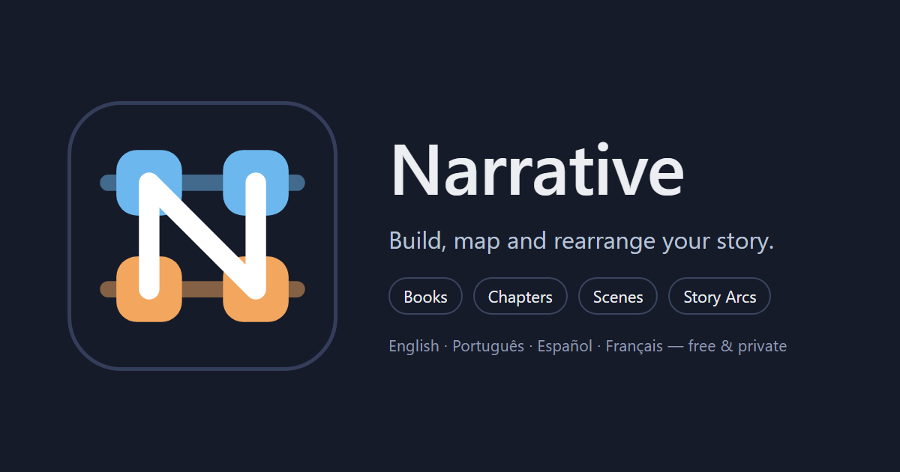
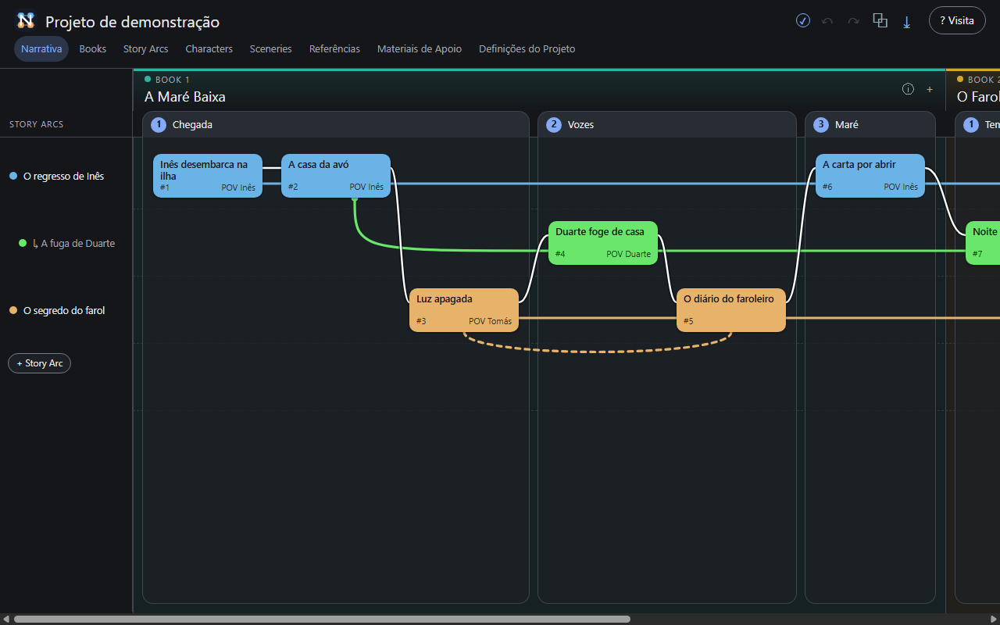

<p align="center">
  
</p>

# Narrative

A free, non-profit tool to **build, map and rearrange stories**: Books, Chapters, Scenes and Story Arcs on one board, with details panels for Characters, Locations, Notes and References, a writing schedule, and a Writing Guide for each language.

**Open Narrative:** <https://hvs87.github.io/narrative/>
**Desktop app (Windows, macOS, Linux):** [releases page](https://github.com/HVS87/narrative/releases/latest)

Available in **English, Português, Español and Français**. The first time it opens, Narrative follows your operating system's language; you can change it in Settings, and the choice is remembered.

> **Privacy.** Narrative is free and non-profit. All your data is stored only on your computer or device; the app collects no data and no analytics. There are no accounts, ads or third-party cookies. If you choose to sync two devices, the project travels encrypted directly from one to the other.



## What it does

**The board**
- Each **Book** is a column, each **Chapter** a block inside it, each **Scene** a card.
- Each **Story Arc** has its own horizontal lane and colour; **Branches** (divergences) sit right below the Story Arc they come from.
- The white line links Scenes in **Narrative Order**; coloured lines link each Story Arc's Scenes in **Chronological Order** (dashed when time goes back).
- Everything can be dragged — Scenes, Chapters and Books — with a live preview; the move is done at once and a bar offers **Undo**. Convergences are created by dragging a Story Arc's handle onto another Scene.
- Each Scene card shows its status — not written, written, revised — and one click moves it on.
- **Filters** highlight the Scenes of a Character, a POV, a Location or a status; each Story Arc has a tick to collapse its lane. Nothing in the project changes.
- Three **views**: Board, Compact (Scenes as labels) and List (also reorderable by dragging); **zoom** with − / +, Ctrl + wheel and “Fit”, and a **mini-map** of the whole story.
- Two bookmark lines show where you are: **"You're writing here"** before the first Scene still to write, and **"You're revising here"** before the first Scene still to revise (on the board and in the List view).

**Schedule & Goals** — research, writing and revision phases on a timeline you can drag, progress rings, writing and revision side by side for every Scene, research goals, a calendar where events can be dragged to another day, and export to Google Calendar, Apple Calendar and Outlook.

**Details and lists** — Scene, Book (with its Chapters on the same page), Story Arc, Character, Location and Reference details, all linked; Characters and Locations can be main or secondary (a Location used in three Scenes is suggested as main); Characters, Locations and References can be imported from another open project; in a centred window or in a **side panel** that leaves the board in view; lists with search, sorting, cards or rows, Character initials and a **presence strip** showing where each element appears in the story; References (documents, links, audio, video, notes) stored on the device.

**Search and shortcuts** — one search box (press `/` or Ctrl K) finds Scenes, Chapters, Characters, Locations, Story Arcs, References and Writing Guide entries, and runs actions such as “new character” or “light theme”; press `?` for the keyboard shortcuts.

**Stepping through the story** — Scene details open with a route strip: two thick lines, as on the board, linking the previous and next Scene in the book (white) and in the Story Arc (the Arc's colour), with branches and convergences drawn. Click a Scene on the strip, use the round arrows beside the details, or press ← → (with Shift, along the Story Arc); the details slide to the next Scene without closing.

**Projects** — several open at once, save to and open from a file, automatic saving of every change, undo/redo up to 100 steps. Start blank, from an **example** you can edit, or from a structure **template** (three acts, the hero's journey, two timelines).

**Writing Guide** — a reference library rebuilt for each language (not just translated): narrator types, figures of speech, style, narrative devices and techniques, planning methods, genres and movements, spelling, punctuation (including *when to use what*), grammar and older forms of the language. The spelling sections include searchable **word lists** of what changed in each spelling reform (for Portuguese: 1911, 1945, 1973 and 1990).

**Across devices** — phone ↔ PC sync with a one-time 6-character code (encrypted, device to device), a second window for a second screen, automatic updates, installable as an app, works offline.

**Accessibility** — text size, reduced motion, stronger contrast and underlined links in Settings; Story Arc colours chosen to stay distinguishable with protanopia, deuteranopia and tritanopia (and nothing depends on colour alone); full keyboard use; a screen-reader-friendly List view of the story.

## Install

| Where | How |
|---|---|
| **Windows** | Download the **installer** or the **portable** app from the [releases page](https://github.com/HVS87/narrative/releases/latest). The files are not code-signed, so the first time Windows shows a warning: "More info" › "Run anyway". |
| **macOS** (Intel and Apple silicon) | Download the `.dmg` from the [releases page](https://github.com/HVS87/narrative/releases/latest) and drag Narrative to Applications. It is not signed: the first time, right-click the app › "Open". |
| **Linux** | Download the `.AppImage` from the [releases page](https://github.com/HVS87/narrative/releases/latest), make it executable (`chmod +x`) and run it; a `.tar.gz` is also available. |
| **Chrome or Edge (Windows, macOS, Linux)** | Open the address and choose "Install Narrative" in the ⋮ menu or the address bar. |
| **Android** | In Chrome: ⋮ › "Install app" or "Add to Home screen". |
| **iPhone and iPad** | In Safari: Share › "Add to Home Screen". |

Narrative updates itself in every case.

## For developers

No dependencies and no build step: plain HTML, CSS and JavaScript, served as is (GitHub Pages). The source code and comments are in Portuguese.

```
index.html, styles.css      page and styles
js/i18n.js                  languages: _('Portuguese text') looks the text up in js/lang-en|es|fr.js
js/                         code (core, board, fichas, tabs, nav, projects, plan, sync, update, tour, tips, prefs…)
js/apoio-*.js               Writing Guide (Portuguese: apoio-pt-0, apoio-a…i; others: apoio-en|es|fr-1…3)
js/vendor/peerjs.min.js     sync library (PeerJS 1.5.4, MIT licence)
js/version.js               published version — the only thing to change for each release
sw.js, manifest.webmanifest installable app and offline use
desktop/                    desktop app for Windows, macOS and Linux (Electron)
.github/workflows/          builds and publishes the desktop app when a vX.Y.Z tag is pushed
qa/                         tests
```

**Run locally:** serve the folder with any static server (for example `npx serve .`) and open the address.

**Tests** (need Chrome, Firefox and/or Edge installed):

```
node qa/run.js chrome firefox edge   # in-page test suite, in each browser
node qa/pwa.js                       # install on PC and phone, offline use, automatic update
node qa/desktop.js                   # Windows app + simulated phone: pairing and sync
```

**Desktop app:** pushing a tag `vX.Y.Z` (matching `desktop/package.json`) makes GitHub Actions build the Windows, macOS and Linux apps and attach them to the release. To build locally:

```
cd desktop
npm install
npx electron-builder --publish never   # builds desktop/dist/ for the current system
```

**Publishing a new version:** change the number in `js/version.js` (and in `desktop/package.json`, then push a `vX.Y.Z` tag, for a new desktop app) and push to GitHub; the site and installed apps update themselves.
